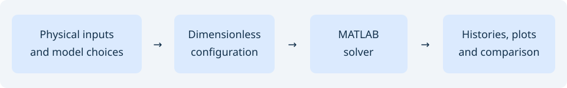

# Inertial Microcavitation Rheometry (IMR)

[](https://github.com/mrodrig6/imrv2/actions/workflows/tests.yml)
[](https://github.com/mrodrig6/imrv2/actions/workflows/docs.yml)
[](https://github.com/mrodrig6/imrv2/actions/workflows/lint.yml)
[](https://github.com/mrodrig6/imrv2/actions/workflows/format.yml)
[](https://github.com/mrodrig6/imrv2/actions/workflows/spellcheck.yml)
[](LICENSE)

IMR simulates a spherical cavitation bubble in a viscoelastic material. Researchers use its bubble-radius histories to compare with high-speed measurements and study soft materials at high strain rates.



- Bubble radius, wall velocity and pressure with Rayleigh–Plesset, Keller–Miksis or Gilmore dynamics.
- Bubble and medium temperatures, with optional vapor mass transfer in the nodal solver.
- Viscoelastic stress models and Newtonian or shear-dependent viscosity.
- Parameter sweeps, measured driving waveforms and numerical test suites.

Extend IMR by adding inputs or constitutive equations along its [documented MATLAB extension path](docs/api/extending.md).

## Install

Use MATLAB R2021a or newer; the forward solvers need base MATLAB. Clone this repository and add `src/` to the MATLAB path. See [installation](docs/getting-started/installation.md) for optional toolboxes and documentation tools.

## Quick start

From a shell with Git and MATLAB available:

```bash
# Get this repository.
git clone https://github.com/mrodrig6/imrv2.git
# Enter the checkout.
cd imrv2
# Read the input-struct help.
matlab -batch "addpath('src'); help f_imr_inputs"
# Run a dimensionless Kelvin–Voigt case.
matlab -batch "addpath('src'); [t,R]=f_imr_nodal('radial',2,'stress',1);"
```

Or use the core API from MATLAB at the checkout root:

```matlab
addpath('src');
p = f_imr_inputs();
p.radial = 2;
p.stress = 1;
[t, R] = f_imr_nodal(p);
```

The [complete quick start](docs/getting-started/quick-start.md) converts SI inputs and restores dimensional outputs. These examples await local MATLAB execution; no numerical output is claimed here.

## Documentation

| Section | Pages |
|---|---|
| Getting started | [Installation](docs/getting-started/installation.md) · [Quick start](docs/getting-started/quick-start.md) · [Examples](docs/getting-started/examples.md) |
| Running | [Commands](docs/running/commands.md) · [Configuration](docs/running/configuration.md) · [Outputs](docs/running/output.md) · [Solvers](docs/running/solvers.md) · [Sweeps](docs/running/sweeps.md) · [Waveforms](docs/running/waveforms.md) · [Collapse](docs/running/collapse.md) · [Troubleshooting](docs/running/troubleshooting.md) |
| MATLAB API | [Overview](docs/api/index.md) · [Nodal solver](docs/api/f_imr_nodal.md) · [Spectral solver](docs/api/f_imr_spectral.md) · [Inputs](docs/api/f_imr_inputs.md) · [Unit conversion](docs/api/f_dim2nondim.md) · [Sweep API](docs/api/f_imr_sweep.md) · [Extending](docs/api/extending.md) |
| Model | [Assumptions](docs/model/overview.md) · [Parameters](docs/model/parameters.md) · [Radial dynamics](docs/model/radial-dynamics.md) · [Stress and viscosity](docs/model/stress-viscosity.md) · [Heat and mass transfer](docs/model/heat-mass-transfer.md) |
| Method | [Workflow](docs/method/overview.md) · [Discretization](docs/method/discretization.md) · [Integration and Jacobians](docs/method/time-integration.md) · [Wall boundaries](docs/method/wall-boundaries.md) · [Initial stress](docs/method/initial-stress.md) · [Benchmarks](docs/method/integrator-benchmarks.md) |
| Theory | [Radial equations](docs/theory/radial-equations.md) · [Stress heating](docs/theory/stress-heating.md) · [Viscosity integrals](docs/theory/viscosity-integrals.md) |
| Validation | [Tests](docs/validation/tests.md) · [Equilibrium](docs/validation/equilibrium.md) · [Gaussian pulse](docs/validation/gaussian.md) · [Permutations](docs/validation/permutations.md) · [Regression](docs/validation/regression.md) · [Operators](docs/validation/operators.md) · [Reported comparisons](docs/validation/convergence.md) |
| Reference | [Compatibility](docs/reference/compatibility.md) · [Code map](docs/reference/code-map.md) · [Repository map](docs/reference/repository.md) · [CI](docs/reference/ci.md) · [Contributing](docs/reference/contributing.md) · [Citation](docs/reference/references.md) · [People](docs/reference/about.md) |

IMR accompanies the inertial-cavitation methods described by Estrada et al. (2017) and Warnez and Johnsen (2015). See [references and citation](docs/reference/references.md) for the project BibTeX and the papers to cite for measured waveforms.

## License

[GNU GPL version 3 or later](LICENSE), copyright the IMR developers.
