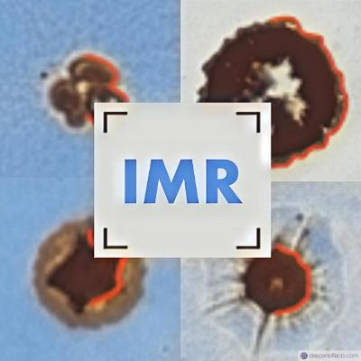

<p align="center">
  <a href="https://github.com/InertialMicrocavitationRheometry/IMRv2">
    
  </a>
</p>

<p align="center">
  <a href="https://doi.org/10.1016/j.jmps.2017.12.006" target="_blank">
    
  </a>
  <a href="https://www.gnu.org/licenses/gpl-3.0.html">
    
  </a>
</p>

# Welcome to IMR

IMR is an advanced computational tool for **Inertial Microcavitation Rheometry (IMR)**, enabling the characterization of soft materials under high strain-rate conditions. IMR correlates the evolution of bubble pressure and stress fields in a material with kinematic observations obtained from high-speed videography.

IMR is actively developed by researchers at multiple institutions (alphabetical):
- [Spencer Bryngelson](https://comp-physics.group/) (Georgia Tech)
- [Jon Estrada](https://me.engin.umich.edu/people/faculty/jon-estrada/) (University of Michigan)
- [Christian Franck](https://directory.engr.wisc.edu/me/Faculty/Franck_Christian/) (University of Wisconsin-Madison)
- [David Henann](https://vivo.brown.edu/display/dhenann) (Brown University)
- [Eric Johnsen](https://me.engin.umich.edu/people/faculty/eric-johnsen/) (University of Michigan)
- [Mauro Rodriguez](https://vivo.brown.edu/display/mrodri97) (Brown University) - **Lead Developer**
- [Jin Yang](https://sites.utexas.edu/yang) (University of Texas at Austin)

For questions, contact [Mauro Rodriguez](mailto:mrodri97@brown.edu) or request to join the IMR Slack workspace.

## Features

IMR offers several key capabilities for modeling and analyzing inertial microcavitation:

- **Bubble Dynamics Simulation**: Implements both finite difference and spectral methods for discretizing partial differential equations, as detailed in:
  - Estrada et al., "High Strain-rate Soft Material Characterization via Inertial Cavitation," [Journal of the Mechanics and Physics of Solids, 2017](https://doi.org/10.1016/j.jmps.2017.12.006).
  - Warnez and Johnsen, "Numerical modeling of bubble dynamics in viscoelastic media with relaxation," [Physics of Fluids, 2015](https://doi.org/10.1063/1.4928860).
- **High Strain-rate Characterization**: Analyzes high-speed video data to extract material properties under dynamic loading.
- **MATLAB Integration**: Provides scripts and functions for simulation control, data analysis, and visualization.
- **Experimental Validation Support**: Facilitates comparison between simulation results and experimental observations.

### Solvers and models

| Solver | Discretization | Notes |
|---|---|---|
| `f_imr_fd` | Finite differences | All models, including vapor mass transfer and collapse |
| `f_imr_spectral` | Chebyshev spectral collocation | No mass transfer or collapse; the only solver with the spectral UCM / Oldroyd-B stress field |

Both solvers include:

- **Radial models:** Rayleigh–Plesset (incompressible), Keller–Miksis in pressure form (constant sound speed), Keller–Miksis in enthalpy form and Gilmore with the Tait equation of state, and the same two with the Mie–Grüneisen equation of state.
- **Heat transfer:** polytropic bubble, heat transfer in the bubble, and heat transfer in the bubble and the surrounding medium.
- **Stress models:** neo-Hookean and quadratic neo-Hookean Kelvin–Voigt; linear Maxwell, Jeffreys and Zener; UCM and Oldroyd-B.
- **Viscosity:** Newtonian and seven non-Newtonian models (Carreau, Carreau–Yasuda, Powell–Eyring, modified Powell–Eyring, Cross, simplified Cross, modified Cross).
- **Driving pressure:** impulse, Gaussian, histotripsy, Heaviside, and three measured waveforms.
- **Time integration:** `ode15s`, `ode23tb` or `ode45`, with an analytic Jacobian for the stiff integrators where one is implemented.

[`docs/compatibility.md`](docs/compatibility.md) shows which of these run together in each solver.

## Getting Started

### Prerequisites

IMR is implemented in **MATLAB** and requires the following dependencies:

- MATLAB (version R2021a or newer recommended)
- Optimization Toolbox (optional but recommended for parameter fitting)
- Image Processing Toolbox (for analyzing high-speed video data)

The solvers use base MATLAB only. Most runs also work in GNU Octave, but Octave lacks `ode23tb`, the default integrator, and differs from MATLAB in a few places; see the notes at the end of [`docs/compatibility.md`](docs/compatibility.md).

### Installation

Clone the repository and navigate to the IMR directory:

```bash
git clone https://github.com/InertialMicrocavitationRheometry/IMRv2.git
cd IMRv2
```

Add IMR to your MATLAB path:

```matlab
addpath(genpath('IMRv2'))
savepath
```

### Dimensionless inputs

The solvers `f_imr_fd` (finite difference) and `f_imr_spectral` (spectral) take and return **dimensionless** quantities only: lengths are scaled by the initial radius `R0`, pressures by the far-field pressure `P8`, velocities by `sqrt(P8/rho8)`, time by `R0/sqrt(P8/rho8)`, and temperatures by the far-field temperature `T8`. The inputs and their defaults are listed in `docs/src/default_case.md`, and `f_checkers` validates every run. To start from physical (SI) values, convert them with the side function `toolchain/f_dim2nondim.m`:

```matlab
addpath('src'); addpath('toolchain');
[varin, ref] = f_dim2nondim('r0',50e-6,'req',5e-6,'mu',1e-2,'g',1e3, ...
    'tvector',linspace(0,12e-6,100));
[t, R] = f_imr_fd(varin{:}, 'radial', 2, 'stress', 1);
plot(t*ref.t0, R*ref.R0);
```

### Running an Example

The scripts `s_run_fdmodel.m`, `s_run_full_model.m` and `s_run_mercury.m` in the repository root run example simulations.

For additional examples, see the `examples/` directory.

## Documentation

- [`docs/compatibility.md`](docs/compatibility.md): which features run together in each solver.
- [`docs/src/default_case.md`](docs/src/default_case.md): every input, its dimensionless definition and its default.
- `docs/src/`: one page per solver and physics function, starting with [`f_imr_fd`](docs/src/f_imr_fd.md) and [`f_imr_spectral`](docs/src/f_imr_spectral.md).
- `docs/toolchain/`: the unit conversion [`f_dim2nondim`](docs/toolchain/f_dim2nondim.md) and the test suites.

## Testing

The test suites live in `toolchain/` and are run from that folder. Each exits with code 0 when it passes.

| Suite | Checks |
|---|---|
| `s_test_suite_compatibility` | Both solvers against stored results, over radial, thermal and stress models |
| `s_test_suite_equilibrium` | A bubble at equilibrium stays there, in both solvers |
| `s_test_suite_gaussian` | A bubble returns to equilibrium after a Gaussian pressure pulse |
| `s_test_suite_masstrans` | The finite difference solver with mass transfer against stored results |
| `s_test_suite_diffmat` | The differentiation operators of `f_diff_mat` |

`toolchain/s_format.m` formats the code and `toolchain/s_lint.m` runs the MATLAB linter; the CI workflows in `.github/workflows` run all of these.

## Citation

If you use IMRv2 in your research, please cite:

```bibtex
@article{Estrada_2017,
  title   = {High Strain-rate Soft Material Characterization via Inertial Cavitation},
  author  = {J. B. Estrada and C. Barajas and D. L. Henann and E. Johnsen and C. Franck},
  journal = {Journal of the Mechanics and Physics of Solids},
  year    = {2017},
  volume  = {112},
  pages   = {291–317},
  doi     = {10.1016/j.jmps.2017.12.006}
}
```

For the numerical methods, see the two papers listed under Features.

## License

IMRv2 is released under the [GNU General Public License v3.0](LICENSE).

## Acknowledgments

IMRv2 development has been supported by funding from the National Science Foundation (NSF), the Department of Defense (DOD), and other research institutions.

## Contact

For issues, bug reports, or feature requests, please open an issue on GitHub or contact the maintainers.

