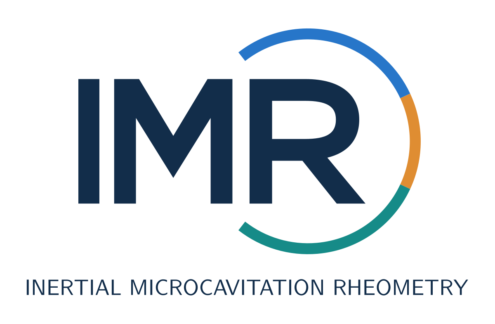

# Inertial Microcavitation Rheometry (IMR)

[](https://github.com/ComputationalFlowGroup/IMRv2/actions/workflows/tests.yml)
[](https://github.com/ComputationalFlowGroup/IMRv2/actions/workflows/docs.yml)
[](https://github.com/ComputationalFlowGroup/IMRv2/actions/workflows/lint.yml)
[](https://github.com/ComputationalFlowGroup/IMRv2/actions/workflows/format.yml)
[](https://github.com/ComputationalFlowGroup/IMRv2/actions/workflows/spellcheck.yml)
[](https://github.com/ComputationalFlowGroup/IMRv2/blob/main/LICENSE)



IMR technique forward solver simulates a spherical cavitation bubble in a viscoelastic material. Researchers use its bubble-radius histories to compare with high-speed measurements and study soft materials at high strain rates. This is the **water-only distribution**; the [main repository](https://github.com/mrodrig6/imrv2) includes additional mercury fluid support.

- Bubble radius, wall velocity, optional wall acceleration and pressure with Rayleigh–Plesset, Keller–Miksis or Gilmore dynamics.
- Bubble and medium temperatures, with optional vapor mass transfer in the nodal solver.
- Viscoelastic stress models and Newtonian or shear-dependent viscosity.
- Water ambient fluid with extensible profile architecture; add custom fluids via the data schema.
- Parameter sweeps, measured driving waveforms and numerical test suites.

Extend IMR by adding inputs or constitutive equations along its [documented MATLAB extension path](docs/reference/extending.md).

## Install

Use MATLAB R2021a or newer; the forward solvers need base MATLAB. Clone this repository and run `imr_setup` once per MATLAB session. See [installation](docs/getting-started/installation.md) for optional toolboxes and documentation tools.

## Quick start

```matlab
imr_setup;
p = imr.default_inputs();
p.radial = 2;
p.stress = 1;
[t, R] = imr.solve(p,'solver','nodal');
```

See the [complete quick start](docs/getting-started/quick-start.md) for SI conversion and plotting; these examples await local MATLAB execution, so no numerical output is claimed here. Use `'solver','spectral'` to select the spectral solver; see the [unified solver API](docs/reference/solve.md).

## Verification

```matlab
run('tests/s_run_verification.m');
```

Runs all available MATLAB test suites from the checkout root. See the [verification runner](tests/README.md#one-command-for-all-tests) for selected suites, explicit golden-data generation, and generation followed by regression; its default test mode never generates or overwrites baselines.

## Documentation

Read the [documentation index](docs/index.md) directly on GitHub for the complete page list, organized by topic. The MkDocs website is deferred; [reactivation instructions](docs/reference/ci.md#reactivating-mkdocs) are retained for later.

IMR accompanies the inertial-cavitation methods described by Estrada et al. (2017) and Warnez and Johnsen (2015). See [references and citation](docs/reference/references.md) for the project BibTeX and the papers to cite for measured waveforms.

## License

[GNU GPL version 3 or later](https://github.com/mrodrig6/imrv2/blob/main/LICENSE), copyright the IMR developers.
