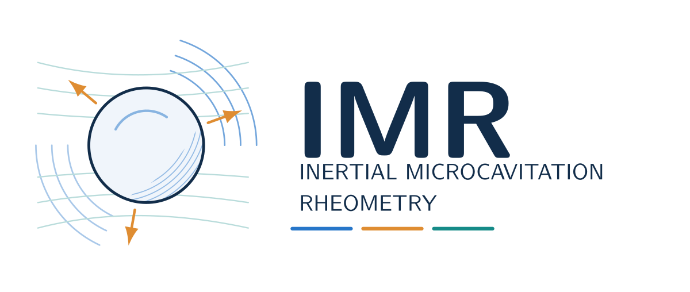

# IMR logo

The IMR logo depicts a cavitation bubble coupled to radial motion, transport and a deformable medium. Its editable TikZ source and compiled SVG/PDF exports are bundled with the code.



The bubble anchors the mark. Blue arcs suggest acoustic propagation, orange arrows suggest heat/mass exchange, and the surrounding teal field suggests a deformable medium. The artwork is schematic, rather than a computed simulation result.

[TeX source](../assets/logos/imr-bubble-field.tex) · [Vector PDF](../assets/logos/imr-bubble-field.pdf) · [SVG](../assets/logos/imr-bubble-field.svg)

## Rebuild

From the checkout root, with TeX Live's `standalone`, TikZ and Latin Modern packages installed:

```bash
mkdir -p /tmp/imr-logos
pdflatex -halt-on-error -output-directory=/tmp/imr-logos docs/assets/logos/imr-bubble-field.tex
pdftocairo -svg /tmp/imr-logos/imr-bubble-field.pdf docs/assets/logos/imr-bubble-field.svg
```

PDF/SVG exports retain vector geometry. MATLAB does not need TeX or these artwork tools.
