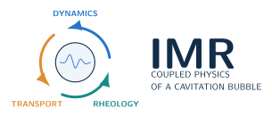
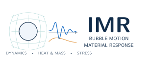

# TikZ logo candidates

These three schematic logos depict the code's capabilities without showing a particular material or claiming a computed result. They are editable TikZ sources with compiled vector SVG and PDF exports. Candidate 1 is the proposed README image; the other two remain alternatives for review.

## 1. Bubble and surrounding fields


The bubble anchors the mark. Blue arcs suggest acoustic propagation, orange arrows suggest heat/mass exchange, and the surrounding teal field suggests a deformable medium. This is the simplest general-purpose wordmark.

[TeX source](../assets/logos/imr-bubble-field.tex) · [Vector PDF](../assets/logos/imr-bubble-field.pdf) · [SVG](../assets/logos/imr-bubble-field.svg)

## 2. Coupled physics



Three arcs emphasize the interaction of radial dynamics, transport and rheology. This option works well when the coupled physics is the main message.

[TeX source](../assets/logos/imr-coupled-physics.tex) · [Vector PDF](../assets/logos/imr-coupled-physics.pdf) · [SVG](../assets/logos/imr-coupled-physics.svg)

## 3. Bubble motion and material response



The lattice connects the bubble to its medium; the curves suggest histories of bubble motion and thermal response. This option emphasizes the relationship between simulation outputs and rheometry measurements. The curves are illustrative artwork, not numerical data or a fitted experiment.

[TeX source](../assets/logos/imr-bubble-response.tex) · [Vector PDF](../assets/logos/imr-bubble-response.pdf) · [SVG](../assets/logos/imr-bubble-response.svg)

## Rebuild

From the checkout root, with TeX Live's `standalone`, TikZ and Latin Modern packages installed:

```bash
mkdir -p /tmp/imr-logos
pdflatex -halt-on-error -output-directory=/tmp/imr-logos docs/assets/logos/imr-bubble-field.tex
pdftocairo -svg /tmp/imr-logos/imr-bubble-field.pdf docs/assets/logos/imr-bubble-field.svg
```

Use the other candidate filenames to rebuild those variants. PDF/SVG exports retain vector geometry; PNG previews are unnecessary for the website. MATLAB does not need TeX or these artwork tools.
