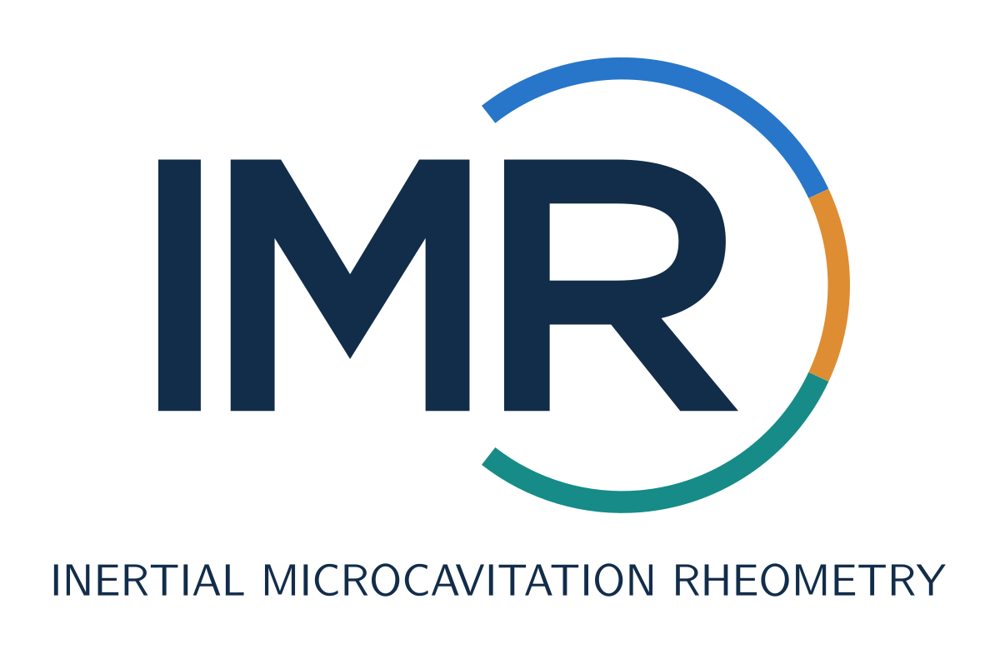

# IMR logo

The IMR monogram integrates an open bubble ring with the letter R. The full name, **Inertial Microcavitation Rheometry**, appears underneath. Its editable TikZ source and SVG/PDF vector exports are bundled with the code.



The mark preserves the original palette: navy lettering (`#122D4A`), blue (`#2776C9`), orange (`#DF8D32`) and teal (`#168B88`) ring segments. The ring suggests a bubble while keeping the identity compact. It contains no arrows or center dot.

[TeX source](../assets/logos/imr-monogram.tex) · [Vector PDF](../assets/logos/imr-monogram.pdf) · [SVG](../assets/logos/imr-monogram.svg)

## Rebuild

From the checkout root, with TeX Live's `standalone`, TikZ and Latin Modern packages installed:

```bash
mkdir -p /tmp/imr-logos
pdflatex -halt-on-error -output-directory=/tmp/imr-logos docs/assets/logos/imr-monogram.tex
pdftocairo -svg /tmp/imr-logos/imr-monogram.pdf docs/assets/logos/imr-monogram.svg
```

The SVG uses a 1200-pixel intrinsic display width so the README logo fills the available content width. After rebuilding it, set the root SVG `width` to `1200`, and set its `height` to `1200 * viewBox height / viewBox width`. Preserve the original `viewBox`; this changes display size while retaining vector quality.

PDF/SVG exports retain vector geometry. MATLAB does not need TeX or these artwork tools.
