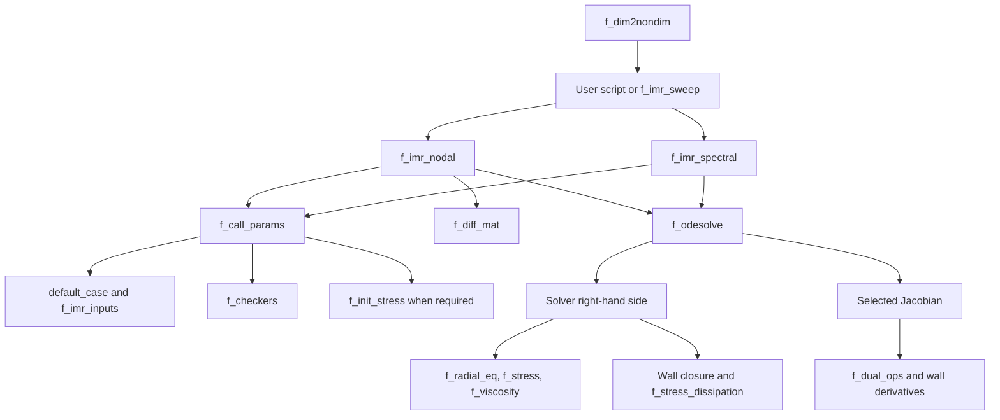

# Code map

This table maps each solver and toolchain module to its role. Public entry points are described in the [MATLAB API](../api/index.md); helper contracts are linked below.

| Module | Purpose | Main entry point / reference |
|---|---|---|
| `src/default_case.m` | Default dimensionless inputs | [`default_case`](../model/parameters.md) |
| `src/f_approx_init_stress.m` | Standalone approximate maximum-radius stress | [`f_approx_init_stress`](functions/f_approx_init_stress.md) |
| `src/f_call_params.m` | Defaults, overrides, derived constants and initialization | [`f_call_params`](functions/f_call_params.md) |
| `src/f_checkers.m` | Input ranges and model compatibility | [`f_checkers`](functions/f_checkers.md) |
| `src/f_diff_mat.m` | Nodal differentiation matrices | [`f_diff_mat`](functions/f_diff_mat.md) |
| `src/f_dim2nondim.m` | SI conversion and scale record | [`f_dim2nondim`](../api/f_dim2nondim.md) |
| `src/f_display.m` | Run labels and diagnostics | [`f_display`](functions/f_display.md) |
| `src/f_dual_ops.m` | Value/derivative operations | [`f_dual_ops`](functions/f_dual_ops.md) |
| `src/f_imr_inputs.m` | Public input struct | [`f_imr_inputs`](../api/f_imr_inputs.md) |
| `src/f_imr_nodal.m` | Nodal finite-difference or Chebyshev forward solver | [`f_imr_nodal`](../api/f_imr_nodal.md) |
| `src/f_imr_spectral.m` | Spectral forward solver | [`f_imr_spectral`](../api/f_imr_spectral.md) |
| `src/f_imr_sweep.m` | Full-grid parameter sweeps | [`f_imr_sweep`](../api/f_imr_sweep.md) |
| `src/f_init_stress.m` | Subsonic growth shooting | [`f_init_stress`](functions/f_init_stress.md) |
| `src/f_jacobian_nodal.m` | Hybrid analytic nodal Jacobian | [`f_jacobian_nodal`](functions/f_jacobian_nodal.md) |
| `src/f_jacobian_spectral.m` | Hybrid analytic spectral Jacobian | [`f_jacobian_spectral`](functions/f_jacobian_spectral.md) |
| `src/f_jpattern.m` | Conservative nodal sparsity pattern | [`f_jpattern`](functions/f_jpattern.md) |
| `src/f_odesolve.m` | Stiff integration wrapper | [`f_odesolve`](functions/f_odesolve.md) |
| `src/f_pinfinity.m` | Driving pressure and derivative | [`f_pinfinity`](functions/f_pinfinity.md) |
| `src/f_pvsat.m` | Water vapor pressure fit | [`f_pvsat`](functions/f_pvsat.md) |
| `src/f_radial_eq.m` | Wall acceleration and liquid EoS | [`f_radial_eq`](functions/f_radial_eq.md) |
| `src/f_stress.m` | Integrated material stress and history derivatives | [`f_stress`](functions/f_stress.md) |
| `src/f_stress_dissipation.m` | Local medium heating | [`f_stress_dissipation`](functions/f_stress_dissipation.md) |
| `src/f_viscosity.m` | Shear-dependent viscosity and quadrature | [`f_viscosity`](functions/f_viscosity.md) |
| `src/f_wall_mass_bc.m` | Wall balance residual and gradient | [`f_wall_mass_bc`](functions/f_wall_mass_bc.md) |
| `src/f_zener_field.m` | Local polymer stress evolution | [`f_zener_field`](functions/f_zener_field.md) |
| `toolchain/f_test_cases.m` | Constructs accepted cases for each mode | `f_test_cases` |
| `toolchain/f_test_report.m` | Prints outcomes and fails the suite | `f_test_report` |
| `toolchain/f_test_run.m` | Runs one case and captures errors | `f_test_run` |
| `toolchain/s_format.m` | Rewrites MATLAB indentation | `s_format` |
| `toolchain/s_generate_references.m` | Guarded reference generation | `s_generate_references` |
| `toolchain/s_lint.m` | Runs checkcode and exits with status | `s_lint` |
| `toolchain/s_test_suite_diffmat.m` | Numerical diffmat suite | `s_test_suite_diffmat` |
| `toolchain/s_test_suite_equilibrium.m` | Numerical equilibrium suite | `s_test_suite_equilibrium` |
| `toolchain/s_test_suite_gaussian.m` | Numerical gaussian suite | `s_test_suite_gaussian` |
| `toolchain/s_test_suite_permutations.m` | Numerical permutations suite | `s_test_suite_permutations` |
| `toolchain/s_test_suite_regression.m` | Numerical regression suite | `s_test_suite_regression` |

## Call structure

The diagram is editable Mermaid source. GitHub and the Material build render it directly; change the block to rebuild it.

`f_pvsat` is called by the SI converter, not the dimensionless solvers. Measured waveform splines load in `f_call_params`; `f_pinfinity` evaluates them. Test suites call `f_test_cases`, then `f_test_run` and `f_test_report`; regression also reads approved stored references.
