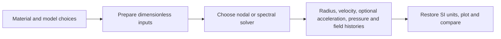
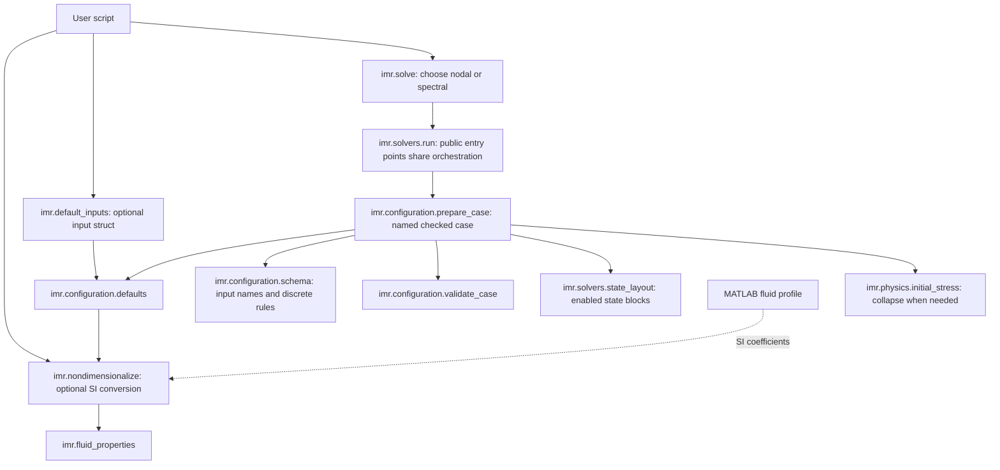
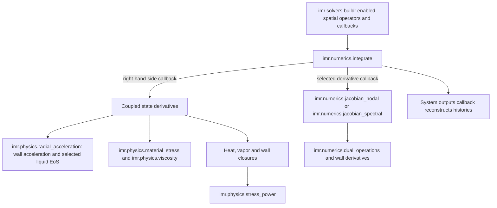

# Code map

Start with the workflow, then follow the implementation diagrams for the part you are changing. The function index at the end groups files by responsibility.

## 1. User workflow

This is a flow of information, rather than a function-call graph. A user may start with SI properties or directly with dimensionless inputs.

Run `imr_setup` once per MATLAB session. Use [`imr.nondimensionalize`](../api/f_dim2nondim.md) for SI input, [`imr.default_inputs`](../api/f_imr_inputs.md) for a dimensionless input struct, and [`imr.sweep`](../api/f_imr_sweep.md) to repeat the workflow across parameter combinations. The [quick start](../getting-started/quick-start.md) provides a complete example.

Stress enters the internal equations; a separate stress history is not part of the public solver output tuple. Enabled thermal and vapor fields are reconstructed by the selected solver. See [outputs](../running/output.md) for returned shapes and scalings.

## 2. Setup: inputs become one checked case

Solid arrows below mean a function calls or uses the target. The dotted arrow supplies material data. SI conversion is optional for users who supply dimensionless inputs directly.

`imr.configuration.defaults` is active code: it provides numerical/model defaults and obtains physical groups from the SI converter. The converter reads the water reference profile for legacy defaults and never calls `imr.configuration.defaults`, so this is not a recursive dependency. Explicit profiles supply material properties; gas, stress and forcing choices remain simulation inputs. See [defaults and units](defaults.md).

## 3. Integration: one checked case becomes histories

The ODE wrapper repeatedly evaluates solver callbacks. Most thermal and wall operations are local functions inside the solver factories; they are not separate top-level entry points.

Material profiles are not loaded in this loop. Pressure-form Keller–Miksis uses prepared ambient density and sound speed; enthalpy branches evaluate their own pressure-based liquid relation in `imr.physics.radial_acceleration`. See [radial equations](../theory/radial-equations.md), [wall boundaries](../method/wall-boundaries.md) and [Jacobians](../method/time-integration.md) for those details.

| State block | Meaning | Active when |
|---|---|---|
| `R`, `Rdot`, `P` | Radius, wall velocity, total bubble pressure | Always |
| `bubble` | Kirchhoff temperature values or coefficients | `bubtherm = 1` |
| `medium` | Medium temperature values or coefficients | `medtherm = 1` |
| `vapor` | Vapor mass fractions | `masstrans = 1`, nodal only |
| `stress1`, `stress2` | Integrated stresses or spectral stress coefficients | Constitutive-model dependent |
| `polymer` | Local Zener stress field for heating | Stress 5–8 with medium heat |

`imr.solvers.state_layout` owns these indices. Factories use the same blocks for initialization, RHS, Jacobians and reconstruction; disabled fields have empty blocks and no operators. See [internal contracts](internal-contracts.md).

## 4. Function index by responsibility

### Entry points and input preparation

| File | Responsibility | Contract |
|---|---|---|
| `imr_setup.m` | Session path setup for public source and examples | [Installation](../getting-started/installation.md) |
| `src/+imr/solve.m` | Common solver selection and optional acceleration | [Unified API](../api/solve.md) |
| `src/+imr/solve_nodal.m` | FD or Chebyshev nodal solver | [Nodal API](../api/f_imr_nodal.md) |
| `src/+imr/solve_spectral.m` | Spectral solver | [Spectral API](../api/f_imr_spectral.md) |
| `src/+imr/sweep.m` | Repeated runs over a full parameter grid | [Sweep API](../api/f_imr_sweep.md) |
| `src/+imr/default_inputs.m` | Public dimensionless input struct | [Inputs](../api/f_imr_inputs.md) |
| `src/+imr/+configuration/defaults.m` | Model/numerical defaults and derived physical groups | [Defaults](defaults.md) |
| `src/+imr/nondimensionalize.m` | SI conversion and reference scales | [Conversion API](../api/f_dim2nondim.md) |
| `src/+imr/+fluids/water.m` | Water reference material coefficients and transport | [Fluid profiles](../model/fluids.md) |
| `src/+imr/fluid_properties.m` | Shared bulk and saturation model evaluation | [Property API](../api/f_fluid_properties.md) |
| `src/+imr/+configuration/prepare_case.m` | Parse, validate and prepare named case fields | [Case contract](internal-contracts.md) |
| `src/+imr/+configuration/schema.m` | Public/internal names and discrete validation rules | [Parameters](../model/parameters.md) |
| `src/+imr/+solvers/state_layout.m` | Enabled state blocks shared by every consumer | [State contract](internal-contracts.md#state-and-shape-contract) |
| `src/+imr/+solvers/build.m` | Build scheme-specific numerical callbacks | [System contract](internal-contracts.md#numerical-system) |
| `src/+imr/+solvers/build_nodal.m`, `build_spectral.m` | Local operators, RHS, closures and reconstruction | [Workflow](../method/overview.md) |
| `src/+imr/+configuration/legacy_options.m` | Compatibility serialization of the named case | [Legacy adapter](functions/f_call_params.md) |
| `src/+imr/+configuration/validate_case.m` | Validate ranges and feature combinations | [Checks](functions/f_checkers.md) |
| `src/+imr/+solvers/describe_case.m` | Display the prepared model choices | [Display](functions/f_display.md) |

### Physical equations

| File | Responsibility | Contract |
|---|---|---|
| `src/+imr/+physics/radial_acceleration.m` | Six radial models and pressure-integrated liquid enthalpy | [Radial closure](functions/f_radial_eq.md) |
| `src/+imr/+physics/polytropic_pressure.m` | Gas pressure derivative with constant vapor pressure | [Polytropic validation](../validation/polytropic.md) |
| `src/+imr/+physics/material_stress.m` | Material stress and auxiliary-state evolution | [Stress](functions/f_stress.md) |
| `src/+imr/+physics/viscosity.m` | Shear-dependent viscosity integrals | [Viscosity](functions/f_viscosity.md) |
| `src/+imr/+physics/stress_power.m` | Local stress power for medium heating | [Heating](functions/f_stress_dissipation.md) |
| `src/+imr/+physics/zener_field.m` | Local polymer stress needed by medium heat transfer | [Zener field](functions/f_zener_field.md) |
| `src/+imr/+physics/wall_mass_balance.m` | Coupled wall residual and its derivatives | [Wall residual](functions/f_wall_mass_bc.md) |
| `src/+imr/+physics/far_field_pressure.m` | Driving pressure and time derivative | [Waveforms](functions/f_pinfinity.md) |
| `src/+imr/+physics/initial_stress.m` | Initial stress from growth shooting | [Initialization](functions/f_init_stress.md) |
| `src/+imr/approximate_initial_stress.m` | Standalone approximation, separate from the solver path | [Approximation](functions/f_approx_init_stress.md) |

### Numerical operators and integration

| File | Responsibility | Contract |
|---|---|---|
| `src/+imr/+numerics/differentiation.m` | Nodal differentiation operators | [Operators](functions/f_diff_mat.md) |
| `src/+imr/+numerics/integrate.m` | Stiff integrator selection and tolerances | [Time integration](functions/f_odesolve.md) |
| `src/+imr/+numerics/jacobian_pattern.m` | Jacobian sparsity structure | [Pattern](functions/f_jpattern.md) |
| `src/+imr/+numerics/jacobian_nodal.m` | Nodal state derivatives | [Nodal Jacobian](functions/f_jacobian_nodal.md) |
| `src/+imr/+numerics/jacobian_spectral.m` | Spectral state derivatives | [Spectral Jacobian](functions/f_jacobian_spectral.md) |
| `src/+imr/+physics/thermal_inverse.m`, `saturation_pressure.m` | Pure transforms shared by RHS, Jacobians and property evaluation | [Thermal variables](../method/time-integration.md#thermal-variables) |
| `src/+imr/+numerics/dual_operations.m` | Shared value/derivative operations | [Dual operations](functions/f_dual_ops.md) |

### Verification and developer tools

| Location | Responsibility |
|---|---|
| `tests/suites/s_test_suite_*.m` | Executable numerical suites; [test index](../validation/tests.md) |
| `tests/+imrtest/` | Frozen reference data, outside the runtime source path |
| `tests/helpers/f_test_cases.m` | Generate accepted cases |
| `tests/helpers/f_test_run.m` | Capture one run, errors and actual times |
| `tests/helpers/f_test_report.m` | Report outcomes and reject failures or empty suites |
| `toolchain/s_generate_references.m` | Guarded regeneration of approved trajectory baselines |
| `toolchain/s_lint.m`, `s_format.m` | MATLAB lint and repository formatting |

## Source layout and file boundaries

`imr_setup` adds the root, `src` and examples once. Public calls use the `imr` namespace. MATLAB resolves `imr.solve_nodal` from `src/+imr/solve_nodal.m`, and the nested packages group configuration, solvers, physics, numerical methods and fluids. Do not add `+` folders individually or use `genpath`.

There is no `private/` folder. Each nodal/spectral implementation exists once, in its solver builder. The two public entry points delegate to `imr.solvers.run`, which shares preparation, integration and reconstruction outside the numerical callbacks. Legacy public names are small adapters in `src`; the numerical kernels call the namespace implementations directly. See [organization and migration](namespaces.md).

Local functions retain tightly coupled wall operations in their owning builder. Shared physical/numerical kernels stay accessible to both solvers and tests. Moving a file into a package changes its qualified name; it does not require an additional runtime dispatcher inside the RHS. The [extension guide](../api/extending.md) describes keeping state, equations, Jacobians and outputs consistent.
