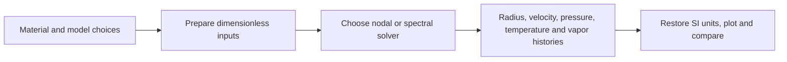
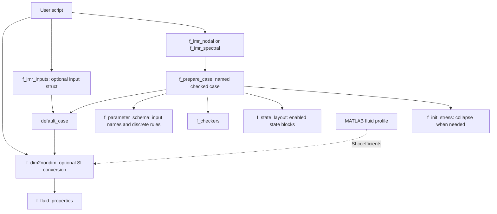
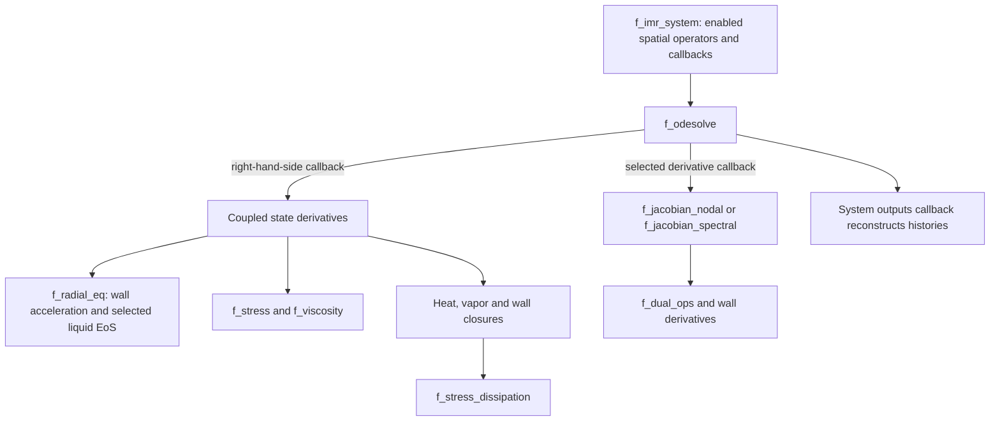

# Code map

Start with the workflow, then follow the implementation diagrams for the part you are changing. The function index at the end groups files by responsibility.

## 1. User workflow

This is a flow of information, rather than a function-call graph. A user may start with SI properties or directly with dimensionless inputs.

Run `imr_setup` once per MATLAB session. Use [`f_dim2nondim`](../api/f_dim2nondim.md) for SI input, [`f_imr_inputs`](../api/f_imr_inputs.md) for a dimensionless input struct, and [`f_imr_sweep`](../api/f_imr_sweep.md) to repeat the workflow across parameter combinations. The [quick start](../getting-started/quick-start.md) provides a complete example.

Stress enters the internal equations; a separate stress history is not part of the public solver output tuple. Enabled thermal and vapor fields are reconstructed by the selected solver. See [outputs](../running/output.md) for returned shapes and scalings.

## 2. Setup: inputs become one checked case

Solid arrows below mean a function calls or uses the target. The dotted arrow supplies material data. SI conversion is optional for users who supply dimensionless inputs directly.

`default_case` is active code: it provides numerical/model defaults and obtains physical groups from the SI converter. The converter reads the water reference profile for legacy defaults and never calls `default_case`, so this is not a recursive dependency. Explicit profiles supply material properties; gas, stress and forcing choices remain simulation inputs. See [defaults and units](defaults.md).

## 3. Integration: one checked case becomes histories

The ODE wrapper repeatedly evaluates solver callbacks. Most thermal and wall operations are local functions inside the private system factories; they are not separate top-level entry points.

Material profiles are not loaded in this loop. Pressure-form Keller–Miksis uses prepared ambient density and sound speed; enthalpy branches evaluate their own pressure-based liquid relation in `f_radial_eq`. See [radial equations](../theory/radial-equations.md), [wall boundaries](../method/wall-boundaries.md) and [Jacobians](../method/time-integration.md) for those details.

| State block | Meaning | Active when |
|---|---|---|
| `R`, `Rdot`, `P` | Radius, wall velocity, total bubble pressure | Always |
| `bubble` | Kirchhoff temperature values or coefficients | `bubtherm = 1` |
| `medium` | Medium temperature values or coefficients | `medtherm = 1` |
| `vapor` | Vapor mass fractions | `masstrans = 1`, nodal only |
| `stress1`, `stress2` | Integrated stresses or spectral stress coefficients | Constitutive-model dependent |
| `polymer` | Local Zener stress field for heating | Stress 3–4 with medium heat |

`f_state_layout` owns these indices. Factories use the same blocks for initialization, RHS, Jacobians and reconstruction; disabled fields have empty blocks and no operators. See [internal contracts](internal-contracts.md).

## 4. Function index by responsibility

### Entry points and input preparation

| File | Responsibility | Contract |
|---|---|---|
| `imr_setup.m` | Session path setup for public source and examples | [Installation](../getting-started/installation.md) |
| `src/f_imr_nodal.m` | FD or Chebyshev nodal solver | [Nodal API](../api/f_imr_nodal.md) |
| `src/f_imr_spectral.m` | Spectral solver | [Spectral API](../api/f_imr_spectral.md) |
| `src/f_imr_sweep.m` | Repeated runs over a full parameter grid | [Sweep API](../api/f_imr_sweep.md) |
| `src/f_imr_inputs.m` | Public dimensionless input struct | [Inputs](../api/f_imr_inputs.md) |
| `src/default_case.m` | Model/numerical defaults and derived physical groups | [Defaults](defaults.md) |
| `src/f_dim2nondim.m` | SI conversion and reference scales | [Conversion API](../api/f_dim2nondim.md) |
| `src/+fluids/water.m` | Water reference material coefficients and transport | [Fluid profiles](../model/fluids.md) |
| `src/f_fluid_properties.m` | Shared bulk and saturation model evaluation | [Property API](../api/f_fluid_properties.md) |
| `src/f_prepare_case.m` | Parse, validate and prepare named case fields | [Case contract](internal-contracts.md) |
| `src/f_parameter_schema.m` | Public/internal names and discrete validation rules | [Parameters](../model/parameters.md) |
| `src/f_state_layout.m` | Enabled state blocks shared by every consumer | [State contract](internal-contracts.md#state-and-shape-contract) |
| `src/f_imr_system.m` | Build scheme-specific numerical callbacks | [System contract](internal-contracts.md#numerical-system) |
| `src/private/imr_nodal_system.m`, `imr_spectral_system.m` | Local operators, RHS, closures and reconstruction | [Workflow](../method/overview.md) |
| `src/f_call_params.m` | Compatibility serialization of the named case | [Legacy adapter](functions/f_call_params.md) |
| `src/f_checkers.m` | Validate ranges and feature combinations | [Checks](functions/f_checkers.md) |
| `src/f_display.m` | Display the prepared model choices | [Display](functions/f_display.md) |

### Physical equations

| File | Responsibility | Contract |
|---|---|---|
| `src/f_radial_eq.m` | Six radial models and pressure-integrated liquid enthalpy | [Radial closure](functions/f_radial_eq.md) |
| `src/f_polytropic_pressure.m` | Gas pressure derivative with constant vapor pressure | [Polytropic validation](../validation/polytropic.md) |
| `src/f_stress.m` | Material stress and auxiliary-state evolution | [Stress](functions/f_stress.md) |
| `src/f_viscosity.m` | Shear-dependent viscosity integrals | [Viscosity](functions/f_viscosity.md) |
| `src/f_stress_dissipation.m` | Local stress power for medium heating | [Heating](functions/f_stress_dissipation.md) |
| `src/f_zener_field.m` | Local polymer stress needed by medium heat transfer | [Zener field](functions/f_zener_field.md) |
| `src/f_wall_mass_bc.m` | Coupled wall residual and its derivatives | [Wall residual](functions/f_wall_mass_bc.md) |
| `src/f_pinfinity.m` | Driving pressure and time derivative | [Waveforms](functions/f_pinfinity.md) |
| `src/f_init_stress.m` | Initial stress from growth shooting | [Initialization](functions/f_init_stress.md) |
| `src/f_approx_init_stress.m` | Standalone approximation, separate from the solver path | [Approximation](functions/f_approx_init_stress.md) |

### Numerical operators and integration

| File | Responsibility | Contract |
|---|---|---|
| `src/f_diff_mat.m` | Nodal differentiation operators | [Operators](functions/f_diff_mat.md) |
| `src/f_odesolve.m` | Stiff integrator selection and tolerances | [Time integration](functions/f_odesolve.md) |
| `src/f_jpattern.m` | Jacobian sparsity structure | [Pattern](functions/f_jpattern.md) |
| `src/f_jacobian_nodal.m` | Nodal state derivatives | [Nodal Jacobian](functions/f_jacobian_nodal.md) |
| `src/f_jacobian_spectral.m` | Spectral state derivatives | [Spectral Jacobian](functions/f_jacobian_spectral.md) |
| `src/f_thermal_inverse.m`, `f_saturation_pressure.m` | Pure transforms shared by RHS, Jacobians and property evaluation | [Thermal variables](../method/time-integration.md#thermal-variables) |
| `src/f_dual_ops.m` | Shared value/derivative operations | [Dual operations](functions/f_dual_ops.md) |

### Verification and developer tools

| Location | Responsibility |
|---|---|
| `toolchain/s_test_suite_*.m` | Executable numerical suites; [test index](../validation/tests.md) |
| `tests/fixtures/+imrtest/` | Frozen reference data, outside the runtime source path |
| `toolchain/f_test_cases.m` | Generate accepted cases |
| `toolchain/f_test_run.m` | Capture one run, errors and actual times |
| `toolchain/f_test_report.m` | Report outcomes and reject failures or empty suites |
| `toolchain/s_generate_references.m` | Guarded regeneration of approved trajectory baselines |
| `toolchain/s_lint.m`, `s_format.m` | MATLAB lint and repository formatting |

## Source layout and file boundaries

A single `imr_setup` call adds `src/` and `examples/`; it does not recursively add every subfolder. MATLAB packages such as `+fluids` resolve through their parent directory and are called as `fluids.water()`. Ordinary subfolders would need path setup, while a `private/` folder can hide helpers used only by its parent. Folders are therefore possible without making callers manage a long list of paths.

Keep shared numerical and physics functions callable from both solvers and their tests. MATLAB local functions in a combined file are visible only within that file; combining them arbitrarily would require duplicate implementations or a dispatcher. Existing material evaluators already group model-family helpers locally, and each private system factory groups its tightly coupled wall closures. Those are useful consolidation boundaries. The [extension guide](../api/extending.md) describes how to keep the state, right-hand side, Jacobian and outputs consistent.

## Optional material add-on

The full distribution also includes `src/+fluids/mercury.m`, the [mercury model](../model/mercury.md), `toolchain/s_test_suite_mercury.m` and its frozen data in `tests/fixtures/+imrtest/mercury_reference.m`. None is required by the generic defaults or water tests.
